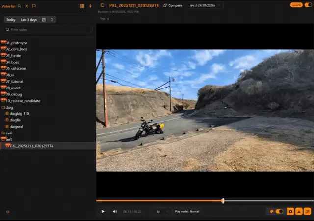
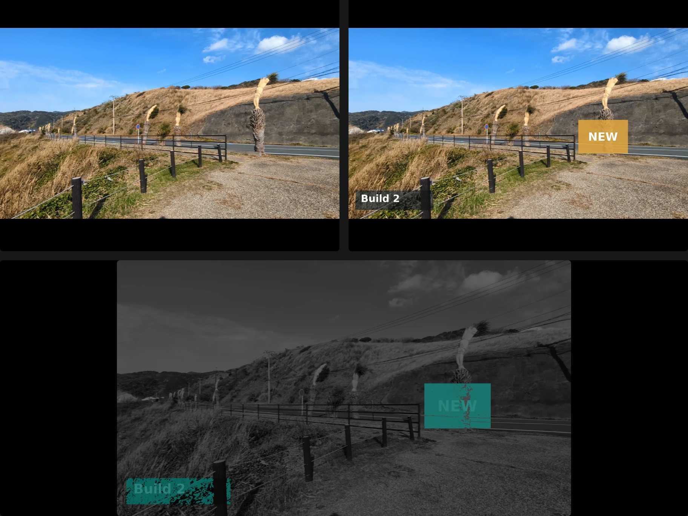
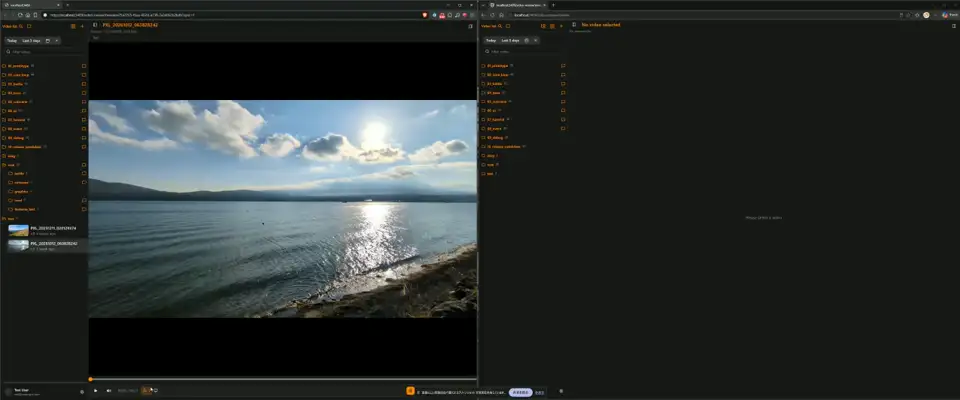
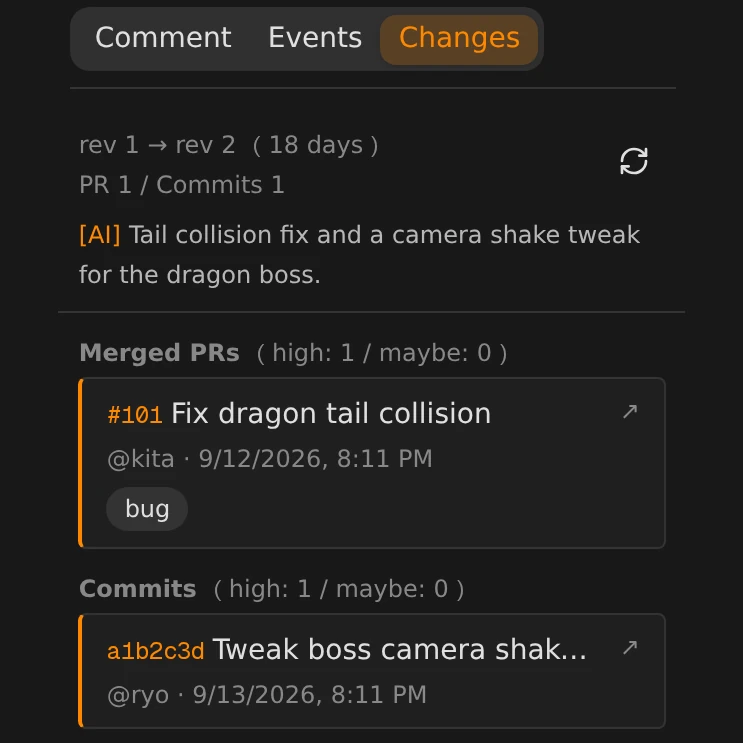
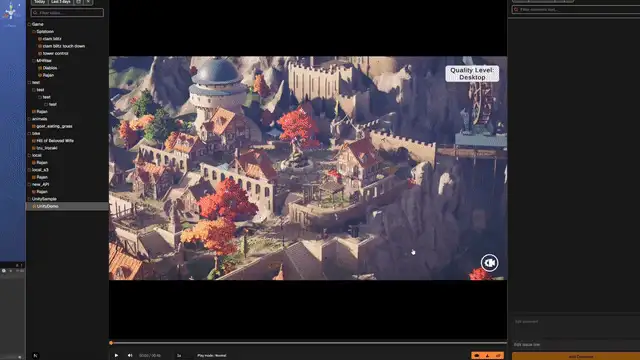
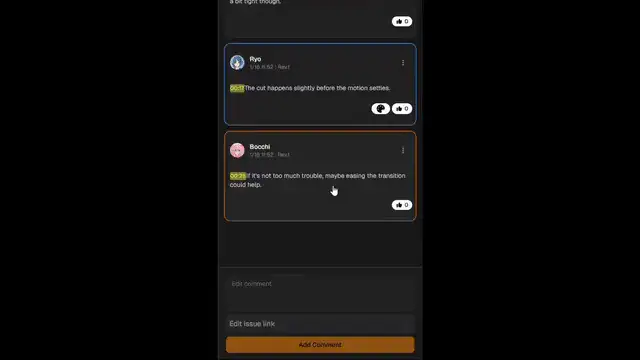

<div align="center">

  <h1>VideoReview</h1>

  <p>
    自社のストレージで動く、ゲーム開発向けの Frame.io
  </p>

  <p>
    <a href="./README.md"></a>
  </p>

  <p>
    <a href="https://github.com/arita-yuto/video-review/stargazers"></a>
    &nbsp;&nbsp;
    <a href="./LICENSE"></a>
  </p>

  

</div>

## レビュー

<table>
  <tr>
    <td width="50%" valign="top">
      <b>動画に直接、描き込む</b><br/>
      場所を言葉で説明せず、止めたフレームに直接描けます<br/><br/>
      
    </td>
    <td width="50%" valign="top">
      <b>リビジョンを見比べる</b><br/>
      グラフィックスの更新による差異をすぐ発見できます<br/><br/>
      
    </td>
  </tr>
  <tr>
    <td colspan="2" valign="top">
      <b>みんなで同時に見る</b><br/>
      画面共有なしで、リンクを開いた全員の再生・停止・シークがそろいます<br/><br/>
      
    </td>
  </tr>
</table>

## ゲーム開発で欲しい機能

<table>
  <tr>
    <td width="33%" valign="top">
      <b>変更の中身を見る</b><br/>
      動画の変更がどの更新が原因になったのかをWebですぐに確認できます<br/><br/>
      
    </td>
    <td width="33%" valign="top">
      <b>Unity / Unreal Engine</b><br/>
      レビュー中の動画からシーンを開き、エディターですぐに確認できます<br/><br/>
      
    </td>
    <td width="33%" valign="top">
      <b>Slack / Jira</b><br/>
      コメントを放置されないようにSlack連携、タスク化もワンクリックでできます<br/><br/>
      
    </td>
  </tr>
</table>

**オンプレミスで動く**：未公開の映像を社外に出さずにレビューできます（S3 や Nextcloud にも置けます）  
**他機能**：検索 · [AI チャット検索](https://arita-yuto.github.io/video-review/ja/features/ai/#2-アプリ内チャット検索を使う) · [MCP](https://arita-yuto.github.io/video-review/ja/features/ai/#3-ai-エージェントから使う) · [メンテナンス CLI](https://arita-yuto.github.io/video-review/ja/features/maintenance-cli/)

## Quick Start (Docker)

```bash
mkdir video-review
cd video-review
curl -L -O https://raw.githubusercontent.com/arita-yuto/video-review/main/compose.prod.yml
docker compose -f compose.prod.yml up -d
```

http://localhost:3489 を開き、管理者アカウントを作成します

## ドキュメント

### 起動方法

- [Docker ガイド](https://arita-yuto.github.io/video-review/ja/install/docker/)
- [Local / On‑premise ガイド](https://arita-yuto.github.io/video-review/ja/install/local/)
- [https ガイド](https://arita-yuto.github.io/video-review/ja/install/https/)

### 設定・連携

- [管理画面ガイド](https://arita-yuto.github.io/video-review/ja/admin/)
- [AI 機能ガイド](https://arita-yuto.github.io/video-review/ja/features/ai/)
- [エディター連携ガイド](https://arita-yuto.github.io/video-review/ja/features/editor/)
- [VCS 連携](https://arita-yuto.github.io/video-review/ja/admin/integrations/vcs/)

## 導入の相談・Contributing・License

- 導入や既存ツールとの連携で困ったら、気軽に相談してください！ videoreview.contact.info@gmail.com
- [CONTRIBUTING.jp.md](./CONTRIBUTING.jp.md) を参照してください
- MIT License
