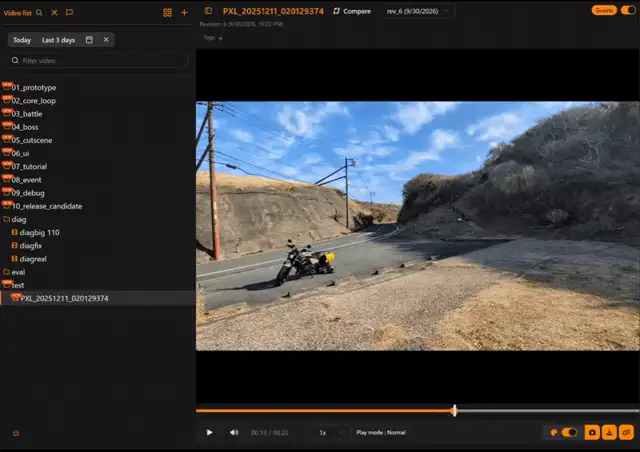
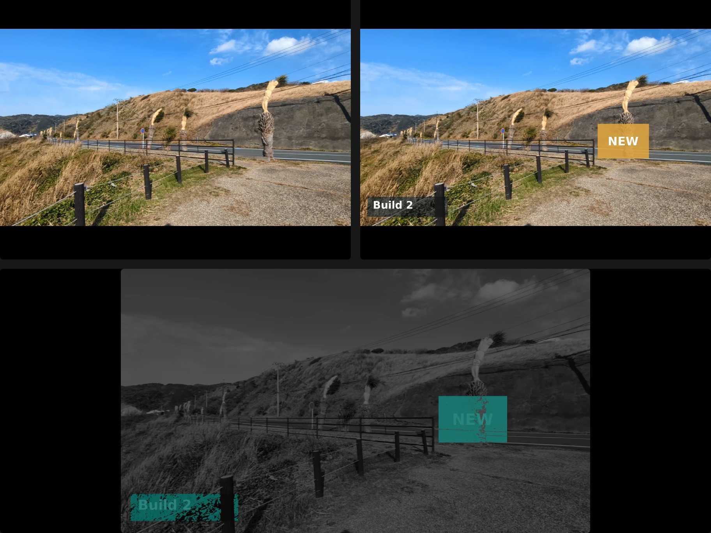
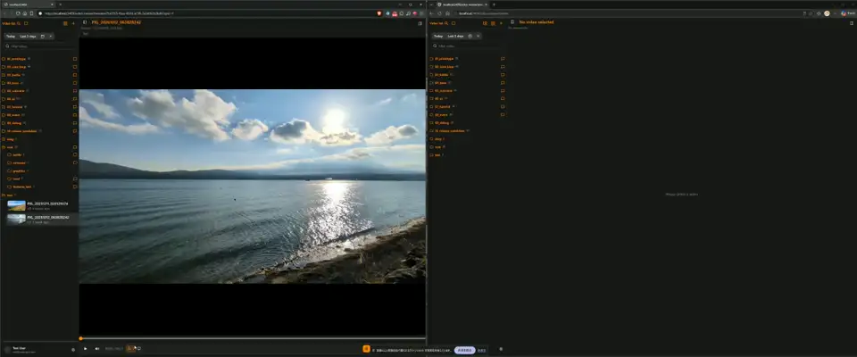
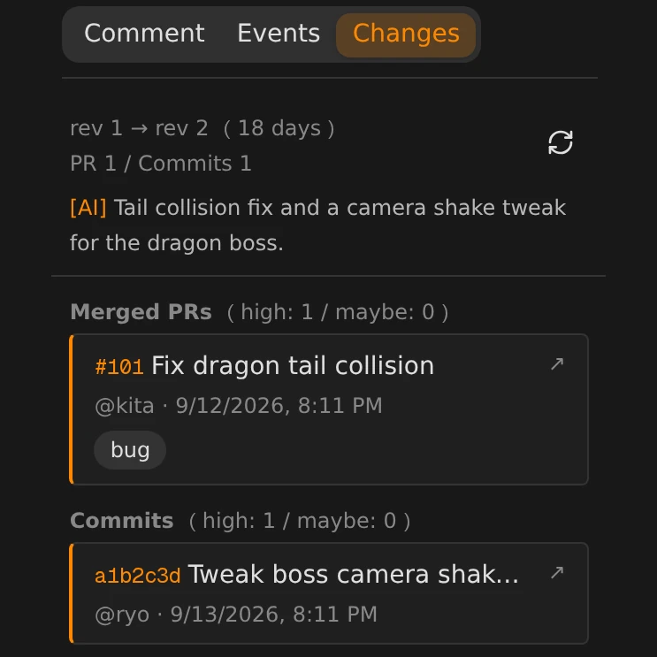
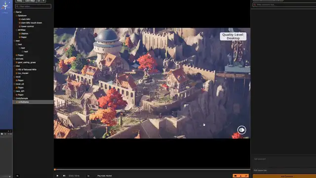
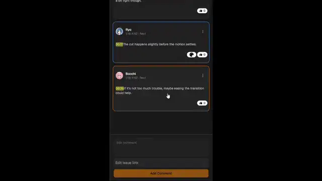

<div align="center">

  <h1>VideoReview</h1>

  <p>
    Frame.io for game teams, running on your own storage.
  </p>

  <p>
    <a href="https://github.com/arita-yuto/video-review/blob/main/README.jp.md"></a>
  </p>

  <p>
    <a href="https://github.com/arita-yuto/video-review/stargazers"></a>
    &nbsp;&nbsp;
    <a href="https://github.com/arita-yuto/video-review/blob/main/LICENSE"></a>
  </p>

  

</div>

## Review

<table>
  <tr>
    <td width="50%" valign="top">
      <b>Draw right on the video</b><br/>
      Draw on the paused frame instead of describing the spot in words.<br/><br/>
      
    </td>
    <td width="50%" valign="top">
      <b>Compare revisions</b><br/>
      Spot what a graphics update changed at a glance.<br/><br/>
      
    </td>
  </tr>
  <tr>
    <td colspan="2" valign="top">
      <b>Watch together</b><br/>
      Without screen sharing, everyone who opens the link plays, pauses and seeks in step.<br/><br/>
      
    </td>
  </tr>
</table>

## Built for game development

<table>
  <tr>
    <td width="33%" valign="top">
      <b>See what changed in the code</b><br/>
      See which update caused a change in the video, right in the browser.<br/><br/>
      
    </td>
    <td width="33%" valign="top">
      <b>Unity / Unreal Engine</b><br/>
      Open the scene from the video under review and check it in the editor right away.<br/><br/>
      
    </td>
    <td width="33%" valign="top">
      <b>Slack / Jira</b><br/>
      Keep comments from being left behind: post them to Slack, or turn them into tasks in one click.<br/><br/>
      
    </td>
  </tr>
</table>

**Runs on-premise**: review unreleased footage without it leaving your network (S3 and Nextcloud work too).  
**Also**: search · [AI chat search](https://arita-yuto.github.io/video-review/features/ai/#2-use-chat-search-in-the-app) · [MCP](https://arita-yuto.github.io/video-review/features/ai/#3-search-from-ai-agents) · [maintenance CLI](https://arita-yuto.github.io/video-review/features/maintenance-cli/)

## Quick Start (Docker)

```bash
mkdir video-review
cd video-review
curl -L -O https://raw.githubusercontent.com/arita-yuto/video-review/main/compose.prod.yml
docker compose -f compose.prod.yml up -d
```

Open http://localhost:3489 and register the first administrator.

## Documentation

### Run

- [Docker guide](https://arita-yuto.github.io/video-review/install/docker/)
- [Local / On‑premise guide](https://arita-yuto.github.io/video-review/install/local/)
- [https guide](https://arita-yuto.github.io/video-review/install/https/)

### Settings & integrations

- [Admin screen guide](https://arita-yuto.github.io/video-review/admin/)
- [AI features guide](https://arita-yuto.github.io/video-review/features/ai/)
- [Editor integration guide](https://arita-yuto.github.io/video-review/features/editor/)
- [VCS integration](https://arita-yuto.github.io/video-review/admin/integrations/vcs/)

## Support · Contributing · License

- Stuck on setup or connecting your tools? Just ask! videoreview.contact.info@gmail.com
- See [CONTRIBUTING.md](./CONTRIBUTING.md).
- MIT License.
