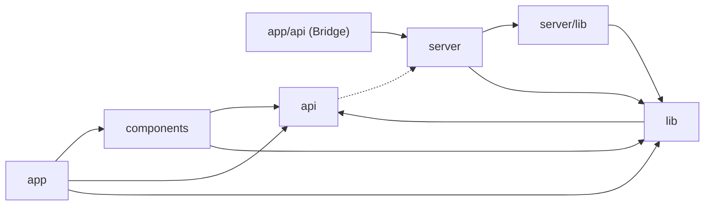
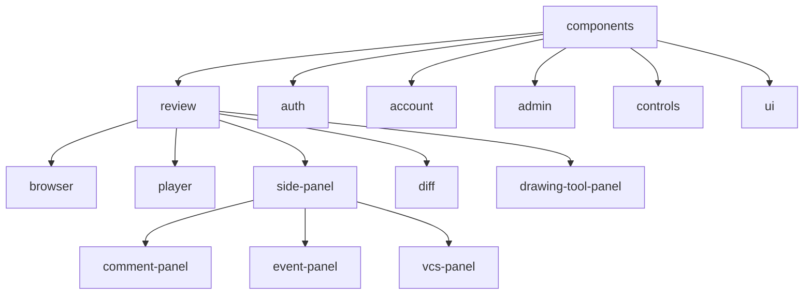
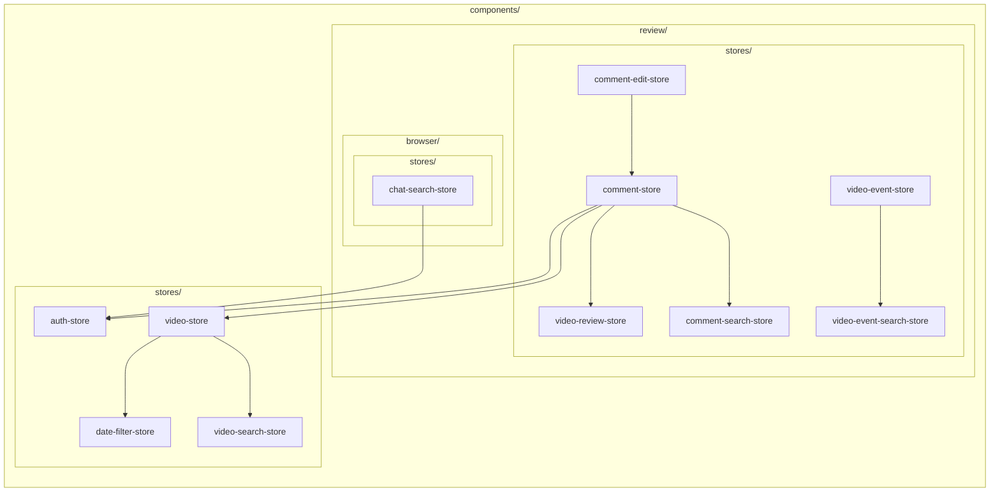

## 1. Dependencies across `src`

There are two `lib` directories: `src/lib` is read by both components and server, and `src/server/lib` only by the server routes.

| Directory | Contents | May import |
|---|---|---|
| app | Pages that read the URL and open the screen | components, api, lib |
| app/api (Bridge) | The one file that mounts Hono in Next.js | server |
| components | Screens, parts, stores, hooks | api, lib |
| api | The HTTP client that talks to the server | server (types only) |
| server | index.ts and the Hono routes in routes/ | server/lib, lib |
| server/lib | What only the server uses (DB, storage, VCS, issue tracker, env) | lib |
| lib | Generic or complex code (types, utilities, upload, media URLs) | api |

The frontend (components, app) and the server never import each other, `import type` included.  
api imports only the server's route types, and only with `import type`.

## 2. Inside components

`src/components` has one directory per screen, and the parts a screen uses sit under it.  
Stores go in `stores/` and hooks in `hooks/`; only files under the parent directory may read them.

Pages in app turn the URL into store state and mount the screen, so they may read `components/stores/` and `review/stores/`.

## 3. Dependencies between stores

A store may read only the stores in the same `stores/` directory or in a parent directory's `stores/`.

Each frame is a directory, and nesting shows the parent.  
Arrows point from the reader to the store it reads, and every arrow stays in its frame or points to an enclosing one.

## 4. ESLint rules

`no-restricted-imports`

- The frontend (components, app) and the server do not import each other (the Bridge excepted)
- lib does not import the frontend or the server
- api does not import the frontend or lib
- api imports only types from the server

`local/store-height`

- Nothing outside the parent directory imports what is in `stores/` or `hooks/` (pages in app may read `components/stores/` and `review/stores/`)

`npm run lint` and CI check these.
