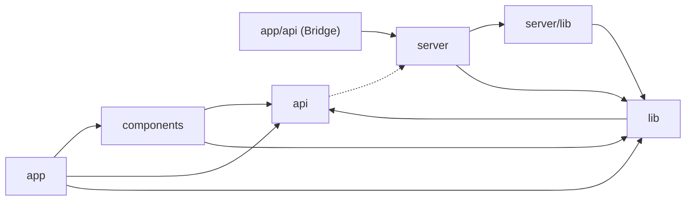
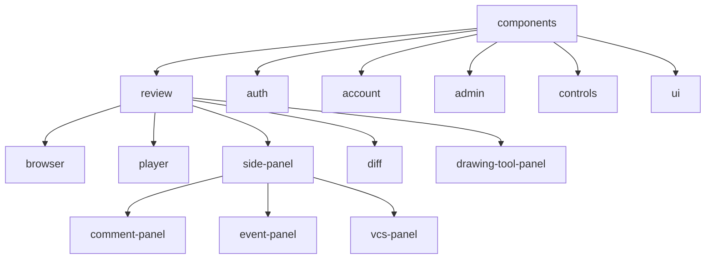
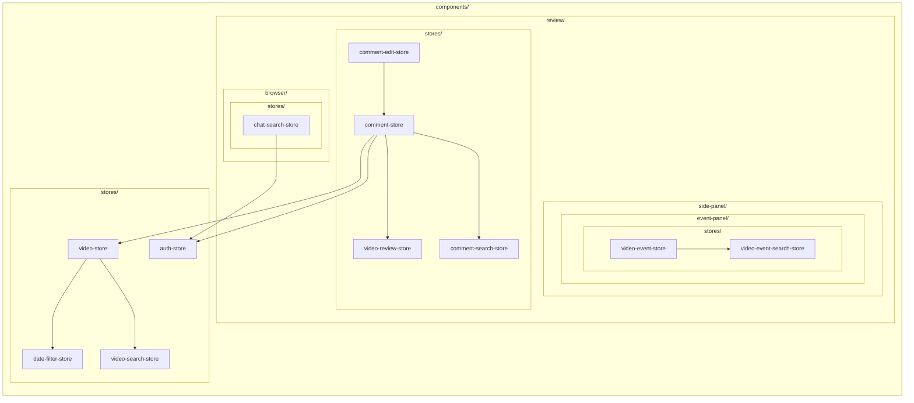

# frontend の依存マップ

## 1. 全体の依存関係

lib は 2 つあり、src/lib は components と server の両方が読み、src/server/lib は server のルートだけが読みます

| ディレクトリ | 中身 | 読めるもの |
|---|---|---|
| app | Next.js のページ | components、api、lib |
| app/api (Bridge) | Hono を Next.js に載せる 1 ファイル | server |
| components | 画面、部品、store、hook | api、lib |
| api | server と話す HTTP クライアント | server（型だけ） |
| server | index.ts と routes/ の Hono ルート | server/lib、lib |
| server/lib | server だけが使うもの（DB、storage、VCS、issue tracker、env） | lib |
| lib | 汎用的なもの、複雑なもの（型、ユーティリティ、アップロード、メディア URL） | api |

frontend（components、app）と server はお互いのものを参照しません（`import type` も含む）  
api は server のルートの型だけを `import type` で参照します

## 2. components の中

`src/components` は画面ごとのディレクトリで、使う部品はその下に置きます  
store は `stores/`、hook は `hooks/` に置き、その親ディレクトリの下にあるファイルだけが読めます

※ app のページは `components/stores/` と `review/stores/` を読むことを例外的に認めています

## 3. store の依存関係

読めるのは、同じディレクトリか親ディレクトリの `stores/` にある store だけです

図の枠はディレクトリで、入れ子が親子を表します
矢印は読む側から読まれる側に向き、同じ枠の中か外側の枠に向いています

## 4. ESLint のルール

`no-restricted-imports`

- frontend（components、app）と server はお互いを import しない（Bridge を除く）
- lib は frontend と server を import しない
- api は frontend と lib を import しない
- api が server から import するのは型だけ

`local/store-height`

- `stores/` と `hooks/` の中身は、その親ディレクトリの外から import しない（app のページだけ `components/stores/` と `review/stores/` を読める）

`npm run lint` と CI でチェックします
